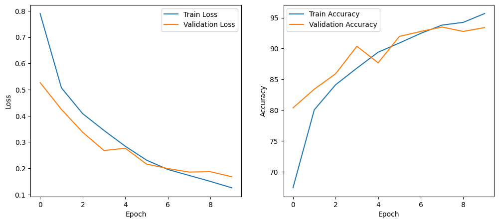
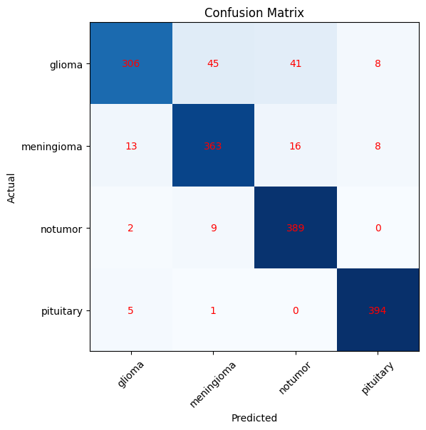

# Brain Tumor MRI Classifier

A four-class brain MRI image classification project built with PyTorch. The notebook covers image loading, augmentation, custom CNN training, and evaluation on a held-out test set.


> **Important:** This is an educational machine-learning project, not a medical device. Its predictions must not be used to diagnose or guide treatment.

## Classes

The model predicts one of four labels:

- Glioma
- Meningioma
- Pituitary tumor
- No tumor

## Results

The saved notebook evaluation reports **90.75% accuracy** across **1,600 test images** (400 per class). The per-class metrics below are copied from its classification report.

| Class                | Precision | Recall | F1-score | Test images |
| -------------------- | --------: | -----: | -------: | ----------: |
| Glioma               |      0.94 |   0.77 |     0.84 |         400 |
| Meningioma           |      0.87 |   0.91 |     0.89 |         400 |
| No tumor             |      0.87 |   0.97 |     0.92 |         400 |
| Pituitary tumor      |      0.96 |   0.98 |     0.97 |         400 |
| **Overall accuracy** |           |        | **0.91** |   **1,600** |

The saved training run reached **95.67% training accuracy** and **93.39% validation accuracy** at epoch 10. Results can differ when the model is retrained.

### Training and validation curves

The plot shows the loss and accuracy recorded over the training run.



### Confusion matrix

This matrix shows the actual and predicted class counts for the test set.



## Approach

- Images are resized to **224 × 224** and converted to tensors.
- Training data uses random horizontal flips and rotations for augmentation.
- The custom CNN has three convolutional blocks (32, 64, and 128 channels), followed by a 256-unit fully connected layer and dropout.
- Training uses `CrossEntropyLoss`, the Adam optimizer, a batch size of 32, and 10 epochs.
- Evaluation includes accuracy, precision, recall, F1-score, and a confusion matrix.

## Dataset

This project uses the [Brain Tumor MRI Dataset on Kaggle](https://www.kaggle.com/datasets/masoudnickparvar/brain-tumor-mri-dataset). The dataset is not included in this repository. Download and extract it so the project contains:

```text
Training/
├── glioma/
├── meningioma/
├── pituitary/
└── notumor/
Testing/
├── glioma/
├── meningioma/
├── pituitary/
└── notumor/
```

## Run the notebook

1. Clone or download this repository and open its directory.

2. Install the listed dependencies:

   ```bash
   pip install -r requirements.txt
   ```

3. Extract the dataset so its root directory contains `Training` and `Testing`.
4. In the notebook's data-loading cell, set `DATA_DIR` to that root directory. For a dataset stored in Google Drive, mount Drive first and use a path such as:

   ```python
   DATA_DIR = "/content/drive/MyDrive/BrainTumorDetection Data"
   ```

5. Open `Brain_tumor_classification.ipynb` in Jupyter or Google Colab and run the cells in order.

## Project files

```text
Brain_tumor_classification.ipynb   # End-to-end training and evaluation
requirements.txt                   # Python dependencies
images/                             # Saved training curves and confusion matrix
```

## Acknowledgements

Dataset: [Masoud Nickparvar's Brain Tumor MRI Dataset](https://www.kaggle.com/datasets/masoudnickparvar/brain-tumor-mri-dataset). This project was developed for learning and portfolio purposes, with reference to the PyTorch documentation and educational resources.

## Author

**Ahmad Raza**
